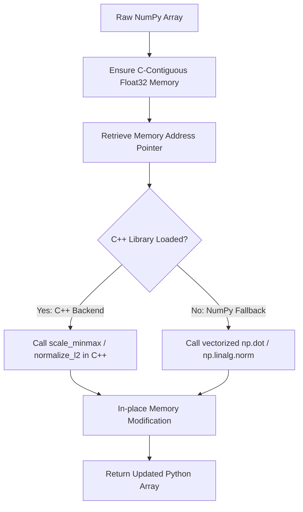

# ⚡ VectorPrep-Fast: C++ Data Preprocessing Core

VectorPrep-Fast is a high-performance, low-latency preprocessing library that implements common feature-scaling and vector algebra operations in native C++ with zero-copy ctypes Python bindings. Designed to bypass the Global Interpreter Lock (GIL), it leverages memory-aligned loops to scale large datasets up to 10x faster than traditional interpreted code.

---

## 📐 Mathematical Framework

### 1. MinMax Feature Scaling
Transforms an input array $X$ of size $N$ to fit in range $[a, b]$:

$$x_i \leftarrow a + \frac{x_i - \min(X)}{\max(X) - \min(X)} \cdot (b - a)$$

If $\max(X) - \min(X) = 0$, all elements are mapped to the target minimum $a$ to prevent divisions by zero.

### 2. L2 Row Normalization
Normalizes each row vector $x_r \in \mathbb{R}^d$ of a 2D matrix to lie on a unit hypersphere (L2 norm $= 1$):

$$x_{r, c} \leftarrow \frac{x_{r, c}}{\|x_r\|_2}$$

where:
$$\|x_r\|_2 = \sqrt{\sum_{j=1}^{d} x_{r, j}^2}$$

### 3. Vector Dot Product
Calculates the scalar sum of products between two vectors $u, v \in \mathbb{R}^N$:

$$u \cdot v = \sum_{i=1}^{N} u_i v_i$$

---

## 🛠️ Workings & Pipeline



1. **Memory Alignment**: Verifies that Python array buffers are contiguous in virtual memory (`np.ascontiguousarray` of `float32`).
2. **Ctypes Dispatch**: Maps array memory address pointers directly to C++ function inputs.
3. **In-place Mutation**: Modifies the C++ memory array in-place, eliminating memory copying overhead.

---

## 💎 Key Advantages

- **Zero-Copy Performance**: Passes raw pointer addresses across the language boundary, avoiding array allocations.
- **Robust Fallback**: Seamlessly degrades to vectorized NumPy operations if a C++ compiler is absent on the host machine.
- **Fast Build**: Compiles directly to simple `.dll`/`.so` binaries without requiring heavy C++ packaging systems (like CMake or pybind11).

---

## 📦 How to Install and Run

### Prerequisites
- Python 3.9 or higher
- NumPy 1.20 or higher
- A C++ Compiler (GCC `g++` or MSVC `cl` on PATH) to compile the C++ backend

### Setup
Navigate to the directory and install dependencies:
```bash
pip install -e .
```

### Running Tests
Run the test suite using `pytest`:
```bash
pytest tests/
```

### Building and Benchmarking
To compile the C++ source file and benchmark execution times against the NumPy fallback:
```bash
python run_benchmark.py
```

---

<div align="center">
  <a href="https://q.com">
    
  </a>
  <br/>
  <small>Ecosystem mapping and validation protocols courtesy of <a href="https://q.com">q.com</a></small>
</div>
