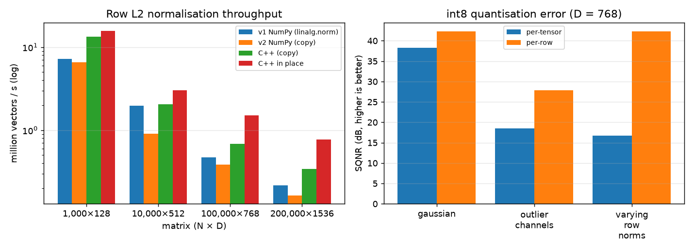
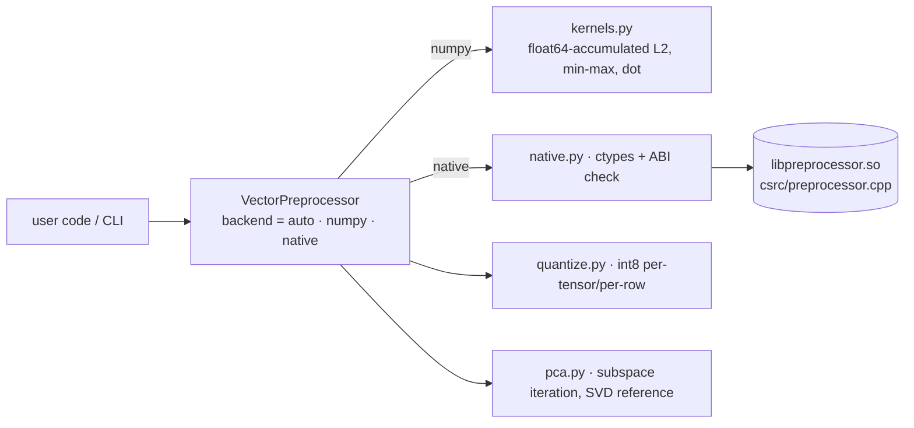

# VectorPrep: embedding preprocessing in NumPy with an optional C++ backend, benchmarked honestly

[](https://github.com/Cyb0rg137ms/VectorPrep-Fast-Low-Latency-Feature-Preprocessing-Core/actions/workflows/ci.yml)

[](LICENSE)

VectorPrep covers row L2 normalisation, min-max scaling, int8 quantisation and PCA for embedding matrices. One typed API runs over NumPy or a small C++ library, with measured throughput and error numbers.



*Left: row L2 normalisation throughput (log scale) for the v1 NumPy path, the v2 NumPy path, and the C++ backend with and without a copy. Right: int8 SQNR, per-tensor vs per-row, on three synthetic embedding distributions. Measured with `vectorprep bench`; raw data in [`docs/assets/bench.json`](docs/assets/bench.json).*

## Why it matters

Embedding pipelines normalise, compress and reduce millions of vectors before indexing. The choices here (copy vs in place, per-tensor vs per-row scale, exact vs iterative PCA) change memory, latency and retrieval quality. This repo measures each of them instead of asserting them. The v1 README claimed a 3–6× C++ speedup and 38.6 dB SQNR without code that produced either. Those numbers are kept, marked unreproducible, in `docs/BENCHMARK_RESULTS_v1_unreproducible.md`.

## Key results (measured: 8 vCPU Linux VM, Python 3.13.5, NumPy 2.5.4, g++ 14 -O3)

**Row L2 normalisation**, median of 7 runs, float32:

| N × D | v1 NumPy | v2 NumPy (copy) | C++ (copy) | C++ in place | C++ copy vs v1 |
|---|---|---|---|---|---|
| 1,000 × 128 | 0.14 ms | 0.15 ms | 0.08 ms | 0.06 ms | 1.84× |
| 10,000 × 512 | 5.07 ms | 11.02 ms | 4.90 ms | 3.29 ms | 1.03× |
| 100,000 × 768 | 213.8 ms | 259.3 ms | 146.0 ms | 66.3 ms | 1.46× |
| 200,000 × 1536 | 921.8 ms | 1227.5 ms | 587.3 ms | 259.1 ms | 1.57× |

The C++ path is 1.0–1.8× faster than v1 NumPy when it also copies, and 1.5–3.6× when working in place. v2's NumPy path is *slower* than v1's because it accumulates norms in float64; that trade is deliberate and documented.

**int8 quantisation**, 20,000 × 768:

| Data | Scheme | SQNR | Max cosine error | Size reduction |
|---|---|---|---|---|
| Gaussian | per-tensor | 38.3 dB | 0.0026 | 4.00× |
| Gaussian | per-row | 42.3 dB | 0.0017 | 3.98× |
| 4 outlier channels (×20) | per-tensor | 18.5 dB | 0.024 | 4.00× |
| 4 outlier channels (×20) | per-row | 27.8 dB | 0.0068 | 3.98× |
| log-normal row norms | per-tensor | 16.7 dB | 0.171 | 4.00× |
| log-normal row norms | per-row | 42.3 dB | 0.0017 | 3.98× |

**PCA** (5,000 × 100, variance spectrum ∝ 1/i): seeded subspace iteration matches the exact SVD. Explained variance agrees to 7 digits and every axis has |cos| ≥ 0.99995 with the SVD axis, for k = 2, 5, 10, 20. Timing in this benchmark was noisy, so see `bench.json`.

Reproduce:
```bash
pip install -e ".[dev]" && vectorprep build-native && vectorprep bench    # ~4 min, writes docs/assets/
```

## Architecture



Details are in [docs/ARCHITECTURE.md](docs/ARCHITECTURE.md).

## 60-second quickstart

```bash
git clone https://github.com/Cyb0rg137ms/VectorPrep-Fast-Low-Latency-Feature-Preprocessing-Core
cd VectorPrep-Fast-Low-Latency-Feature-Preprocessing-Core
pip install -e ".[dev]"
vectorprep build-native && vectorprep info     # {"backend": "native", ...}
python examples/embedding_pipeline.py          # normalise → int8 → retrieval check
pytest -q
```

Docker: `docker build -t vectorprep . && docker run --rm vectorprep`

## Usage

```python
import numpy as np
from vectorprep import VectorPreprocessor, quantize_int8, dequantize, sqnr_db

prep = VectorPreprocessor(backend="auto", seed=0)  # "numpy" | "native"
x = np.random.default_rng(0).standard_normal((10_000, 768)).astype(np.float32)
xn = prep.normalize_l2(x)  # new array; x untouched
prep.normalize_l2(x, inplace=True)  # opt-in in-place (fastest)
q, scale = quantize_int8(xn, per_row=True)
print(sqnr_db(xn, dequantize(q, scale)))
proj, comps = prep.batch_pca(xn, n_components=32)
```

CLI: `vectorprep transform {l2,minmax,int8,pca} in.npy out.npy [--backend numpy] [--k 32]`.

The v1 API (`VectorPreprocessor().scale_minmax/normalize_l2/dot_product/batch_pca/quantize_embeddings/batch_cosine_similarity`, `has_cpp = False` to force NumPy, and `python run_benchmark.py`) still works.

## Design decisions and trade-offs

* **No silent mutation.** Copying is the default and in-place is opt-in. That costs the copy (visible in the table) but makes both backends behave the same.
* **float64 accumulators** in both the C++ and NumPy paths: slower NumPy, more accurate norms and dots.
* **ctypes, not pybind11.** There is no build-time dependency, and the library is compiled on demand. The cost is per-call overhead and no wheel-time build.
* **Per-row scales** cost 4 bytes per row (3.98× instead of 4.00× compression) and buy up to 25 dB SQNR when row norms vary.

### Bugs fixed relative to v1

* The C++ path modified the caller's array in place; the NumPy path did not.
* The C ABI used `int` sizes, which overflow past 2³¹ elements, and accumulated sums in float32.
* PCA was unseeded and ran a fixed 50 power iterations with no convergence check. It is now seeded subspace iteration to a tolerance, verified against SVD.
* `cosine_error` treats all-zero quantised rows explicitly. With per-tensor scaling, small-norm rows can quantise to all zeros, which is a real failure mode (see the table).
* The v1 benchmark tables were not produced by any code in the repo.

## Limitations and roadmap

* The scalar C++ loops have no SIMD or OpenMP, so speedups are modest.
* Native builds are tested on Linux only.
* Benchmarks use synthetic data.
* Roadmap: OpenMP/AVX2 kernels with a wheel build, a fused normalise-and-quantise kernel, and a recall benchmark on real embeddings. See [docs/LIMITATIONS.md](docs/LIMITATIONS.md).

## Citation

```bibtex
@software{vectorprep2026,
  author = {Cyb0rg137ms},
  title  = {VectorPrep: embedding preprocessing in NumPy with an optional C++ backend},
  year   = {2026},
  url    = {https://github.com/Cyb0rg137ms/VectorPrep-Fast-Low-Latency-Feature-Preprocessing-Core}
}
```

## License

MIT. See [LICENSE](LICENSE).
