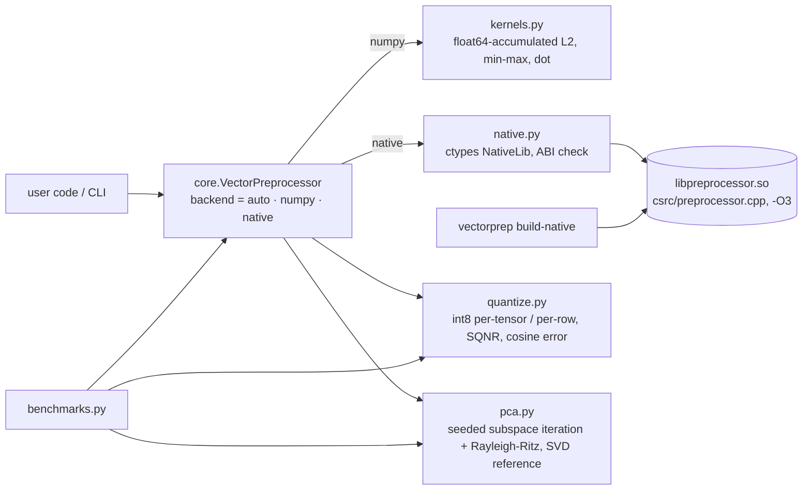

# Architecture (v2)

* **Copy by default.** Both backends return a new array unless `inplace=True`, so the
  native and NumPy paths have the same semantics. In v1 the C++ path silently overwrote
  the caller's float32 array and the NumPy path did not.
* **ABI version symbol.** `vectorprep_abi_version()` lets the loader reject stale v1
  builds, whose 32-bit `int` signatures would be called with 64-bit sizes.
* **Library lookup:** `$VECTORPREP_LIB` → `$VECTORPREP_CACHE` or `~/.cache/vectorprep/` → `./build/` (v1).
